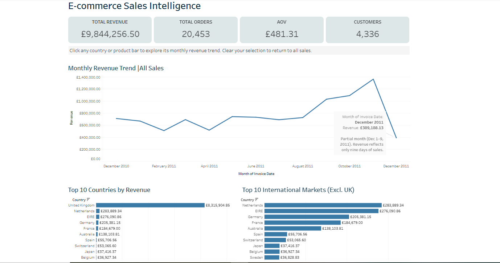

# Sales Intelligence Overview — Tableau Dashboard

## Overview

This interactive Tableau Public dashboard presents sales performance from the [UCI Online Retail dataset](https://archive.ics.uci.edu/dataset/352/online+retail). It brings together key business metrics, monthly revenue trends, and country, product, and customer comparisons.

**[Explore the interactive dashboard on Tableau Public](https://public.tableau.com/views/E-commerceSalesIntelligenceDashboardDevelopment/SalesIntelligenceOverview?:language=en-GB&:sid=&:redirect=auth&:display_count=n&:origin=viz_share_link)**

## Dashboard Contents

The dashboard displays four headline metrics:

| KPI | Value |
|---|---:|
| Total Revenue | £9,844,256.50 |
| Total Orders | 20,453 |
| Average Order Value (AOV) | £481.31 |
| Identifiable Customers | 4,336 |

It also includes a monthly revenue trend and rankings of the top 10 countries, top 10 international markets (excluding the United Kingdom), top 10 products, and top 10 customers by revenue. The international-market view makes smaller markets easier to compare without the UK's dominant revenue contribution.

## Interactive Exploration

Select a bar in either country chart or the product chart to display that selection's monthly revenue trend. The trend title updates to identify the selected country or product. Country and product selections replace one another rather than combining, and clearing a selection returns the trend to **All Sales**.

## Metric Scope and Limitations

Revenue is calculated as `Quantity × UnitPrice` for qualifying transactions. The business metrics exclude cancellation invoices starting with `C`, non-positive quantities, and stock codes `POST`, `DOT`, `M`, `m`, and `23843`. Total Orders counts distinct qualifying invoice numbers; Identifiable Customers counts distinct non-null customer IDs.

These figures represent qualifying sales value, **not profit or fully reconciled net revenue**. December 2011 includes data only through **9 December**, so its monthly revenue should not be compared directly with a full month.

For the underlying methodology, see the [SQL analysis](../04_SQL_Analysis/README.md) and [Python analysis](../03_Python_Analysis/README.md).
