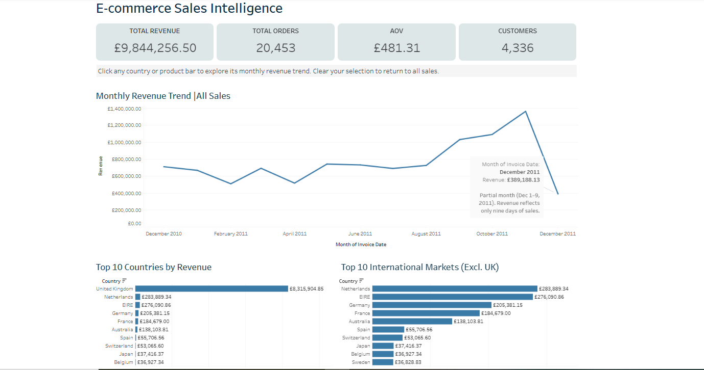

# E-commerce Sales Intelligence

**Analytics Studio · Project 01**

An end-to-end business intelligence portfolio project exploring historical online retail transactions through **Python, Pandas, Google BigQuery (SQL), and Tableau Public**.

The project investigates data quality, defines consistent sales metrics, and presents interactive insights into revenue trends, countries, products, and identifiable customers.

> **Interactive dashboard:** [View E-commerce Sales Intelligence on Tableau Public](https://public.tableau.com/views/E-commerceSalesIntelligenceDashboardDevelopment/SalesIntelligenceOverview)

## Business Questions

- How much qualifying sales revenue was generated, and how many orders were placed?
- How did sales performance change over time?
- Which markets and products contributed most to revenue?
- Which identifiable customers generated the most revenue or placed orders most frequently?

## Tools and Workflow

| Stage | Tools | Work completed |
|---|---|---|
| Exploration | Python, Pandas, Jupyter Notebook | Inspected missing values, duplicates, cancellations, zero-price records, and unusual transactions |
| Preparation | Python, Pandas | Applied documented, selective cleaning decisions and prepared datasets for analysis |
| Business analysis | Google BigQuery, SQL | Defined KPI filters and analyzed revenue, orders, countries, products, and customers |
| Visualization | Tableau Public | Built and published an interactive sales intelligence dashboard |
| Communication | Markdown and project documentation | Documented findings, analytical scope, and limitations |

## Key Performance Indicators

The following results use the SQL business-metric filters defined below.

| KPI | Result |
|---|---:|
| Total qualifying revenue | **£9,844,256.50** |
| Distinct qualifying orders | **20,453** |
| Average order value | **£481.31** |
| Distinct identifiable customers | **4,336** |

**Metric definitions:** Revenue is `Quantity × UnitPrice` for qualifying transaction lines; orders are distinct qualifying `InvoiceNo` values; average order value is qualifying revenue divided by distinct qualifying orders. Identifiable customers are distinct non-null `CustomerID` values.

## Interactive Dashboard

The Tableau dashboard contains:

- Four KPI cards: revenue, orders, average order value, and identifiable customers.
- A monthly revenue trend, with a note identifying the incomplete December 2011 reporting period.
- Top-country and international-market revenue comparisons.
- Top-product and top-customer revenue rankings.
- Interactive country and product exploration: selecting a bar updates the monthly trend and its title. Clearing the selection restores the all-sales view.

**How to explore:** Click a country or product bar to see that selection's monthly revenue trend. Clear the selection to return to overall sales.



## Selected Business Findings

- **Revenue concentration:** The United Kingdom generated **£8,315,904.85**, approximately **84.5%** of qualifying revenue.
- **Monthly peak:** **November 2011** generated **£1,361,604.57** across **2,809** qualifying orders.
- **Leading product by revenue:** **REGENCY CAKESTAND 3 TIER** generated **£169,509.77**.
- **Customer value versus frequency:** Customer **14646** generated the most revenue among identifiable customers (**£279,138.02**), while customer **12748** placed the most orders in the analyzed customer ranking (**206**).

These findings describe patterns in historical transactions; they do not establish causal explanations or guarantee future performance.

## Data and Analytical Scope

**Source:** [UCI Online Retail dataset](https://archive.ics.uci.edu/dataset/352/online+retail), covering transactions from December 2010 through December 9, 2011.

Python preparation investigated data-quality issues and generated multiple analysis-ready datasets. BigQuery applied additional filters for the reported business KPIs:

```sql
WHERE InvoiceNo NOT LIKE 'C%'
  AND Quantity > 0
  AND StockCode NOT IN ('POST', 'DOT', 'M', 'm', '23843')
```

The specific exclusion of stock code `23843` followed investigation of a large positive transaction and a corresponding cancellation record. These filters define the scope of the analysis; they do **not** prove that every return or refund was reconciled.

### Limitations

- Revenue is **qualifying gross transaction value**, **not profit** or fully reconciled net revenue.
- Cancellation, return, and refund effects are not fully reconciled.
- Some records lack customer identifiers; customer KPIs therefore count **identifiable** customers only.
- December 2011 contains only nine days of data and should not be compared with full months as though reporting coverage were equal.
- One historical annual cycle cannot establish recurring seasonality or causation.

## Repository Structure

```text
Project-01-Ecommerce-Sales-Intelligence/
├── 01_Project_Charter/
│   └── Project_Charter
├── 02_Data/
│   ├── README.md
│   ├── Raw/           # Source data (not committed)
│   └── Processed/     # Generated CSV files (not committed)
├── 03_Python_Analysis/
│   ├── 01_Raw_Data_Inspection.ipynb
│   ├── 02_Data_Cleaning.ipynb
│   └── README.md
├── 04_SQL_Analysis/
│   ├── 01_KPI_Analysis.sql
│   ├── 02_Monthly_Sales.sql
│   ├── 03_Country_Analysis.sql
│   ├── 04_Product_Analysis.sql
│   ├── 05_Customer_Analysis.sql
│   └── README.md
├── 05_Dashboard/
│   ├── dashboard_preview.png
│   └── README.md
├── 06_Documentation/
│   └── Project_Analysis_and_Business_Insights.md
├── README.md
└── .gitignore
```

## Explore the Project

- [Project Charter](01_Project_Charter/Project_Charter.md)
- [Python exploration and cleaning](03_Python_Analysis/README.md)
- [SQL KPI analysis](04_SQL_Analysis/01_KPI_Analysis.sql)
- [Monthly sales analysis](04_SQL_Analysis/02_Monthly_Sales.sql)
- [Country analysis](04_SQL_Analysis/03_Country_Analysis.sql)
- [Product analysis](04_SQL_Analysis/04_Product_Analysis.sql)
- [Customer analysis](04_SQL_Analysis/05_Customer_Analysis.sql)
- [Business insights and limitations](06_Documentation/Project_Analysis_and_Business_Insights.md)

## Reproducibility Notes

The source dataset is available from [UCI](https://archive.ics.uci.edu/dataset/352/online+retail). The Jupyter notebooks document exploration and preparation; the BigQuery scripts define the reported metrics. Generated processed CSVs are intentionally excluded from the public repository because of their size.

The Tableau dashboard is published separately through Tableau Public.

---

*Part of Analytics Studio — a portfolio of practical projects using data analysis to support business understanding and decisions.*
